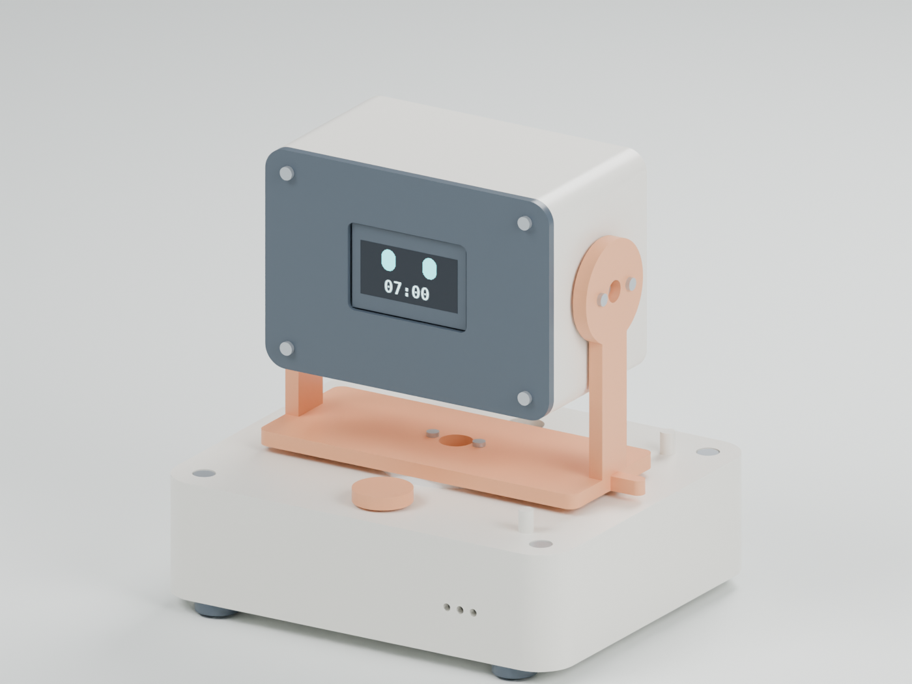
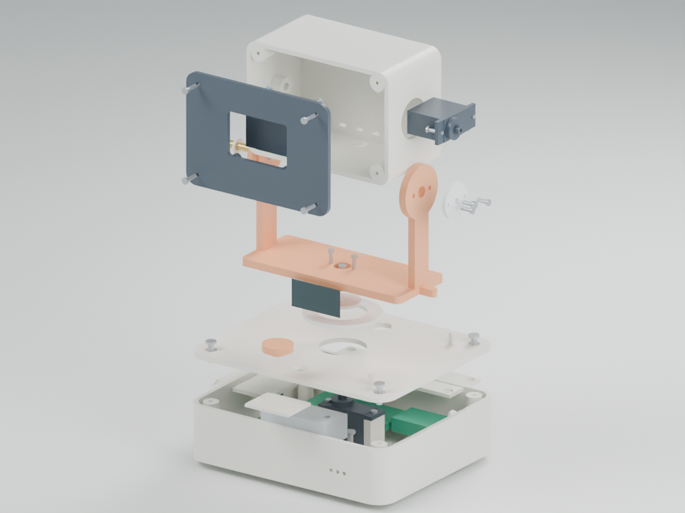
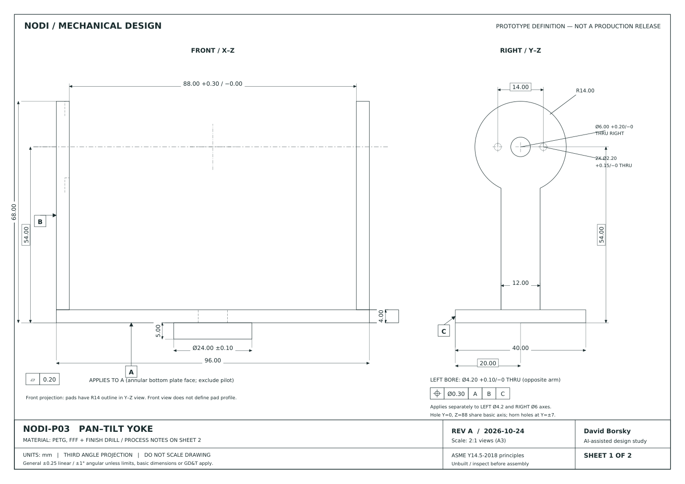
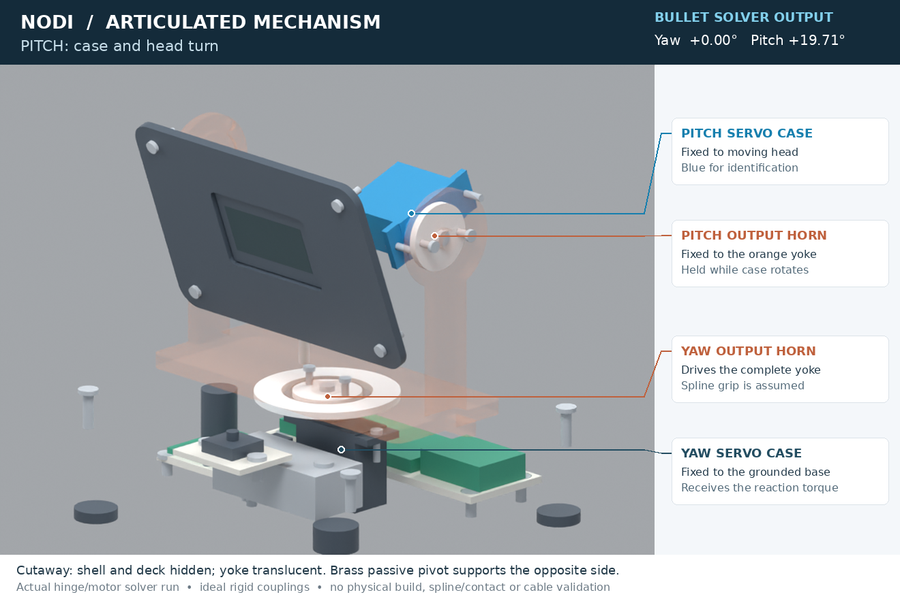

# NODI
## Expressive robotic alarm clock

**Mechanical engineering design challenge · David Borsky · Mechanical A / Electrical B · 25 October 2026**

A two-axis desktop character that physically wakes up with its user. The design combines a serviceable pan-tilt mechanism, a time-and-eye OLED, audible alarm and one accessible snooze/dismiss button.

| Key specification | Revision A definition |
|---|---|
| Motion | Yaw ±30°; pitch −15°/+25°; commanded ≤60 °/s and ≤180 °/s² |
| Envelope | Base 120×100×32 mm; head 86×48×60 mm; pitch axis Z = 88 mm |
| Estimated mass | 375.5 g CAD estimate; 489.3 g design budget; target ≤500 g |
| Main hardware | 2×MG90S; Pico; DS3231; 128×64 OLED; piezo; tactile button |
| Prototype materials | PETG printed rigid parts, PTFE thrust washer, steel ballast |
| Power | Dedicated regulated 5 V/3 A USB source; fuse and Schottky-fed logic |

**Status:** Executed parametric CAD, exports, analytical scripts, ARM firmware compilation, host software tests and an ideal articulated joint-solver demonstration. Detailed electrical schematics and wiring are supplied separately. No fabrication, hardware tests or FEA. Results below are computational checks and calculated estimates. AI assistance was used to create this design package; see the repository provenance record.

<!-- pagebreak -->
## 1. Mechanical architecture and concept choice

NODI uses a U-yoke with a yaw table and an inverse tilt drive. A PTFE annular washer is intended to support axial weight above the removable base deck. The integral pilot locates the table radially. A yaw servo below the deck drives the table through a purchased, match-drilled horn. Actual axial load sharing between the washer and servo shaft remains unverified.

The pitch servo is fixed inside the head while its output horn is fixed to the right yoke arm. The servo case and head therefore rotate together. A brass sleeve, PTFE washer and M3 fastener support the left side. The sleeve length is intended to preserve endfloat with the fastener tightened, but its nominal clearance can be consumed by manufacturing variation. Sleeve rotation is not positively locked. The drive remains inside the head envelope and balances mass around the pitch axis.

| Concept | Weighted score / 5 | Principal tradeoff |
|---|---|---|
| A. Two-axis pan-tilt | 4.13 | Most expressive; two joints and a flexible harness |
| B. Single-axis nod | 3.93 | Easier assembly and lower mechanical risk |
| C. Mechanical eyelids | 3.05 | Expressive face detail; links and small clearances |

Eight criteria cover expression, simplicity, assembly, cost, reliability, risk, integration and 24-hour feasibility. Expressiveness receives 40% because character behavior is central to the brief. A five-percentage-point transfer to simplicity ties A and B; equal weighting selects B. The selection is a documented product preference rather than a uniquely optimal mechanism.

Software limits remain 5° inside hard pitch limits−20°/+30° and yaw±35°. Hard stops are fault arrestors, not normal operating endpoints. The cable harness is not represented as a flexible solid; combined-limit manual sweeps are required after assembly.

<!-- pagebreak -->
## 2. First-principles actuation and structure

All calculations run from a shared CAD manifest and an explicit assumptions file. Masses of custom solids use nominal material density; purchased modules use stated estimates. A25% mass growth allowance and wiring budgets produce a120.7 g moving-head budget. The CAD head CG lies close to the axis; a conservative 10 mm gravity offset is used to cover harness and assembly variation.

**Pitch torque:** τ = SF × (mge + Iα + τfriction + τcable). Use SF = 2, g=9.80665 m/s², α≤πrad/s², assumed friction 0.003 N·m and cable drag 0.002 N·m. Bounding boxes provide conservative inertia limits; these are not measured inertia tensors.

| Calculation | Result | Interpretation |
|---|---|---|
| Pitch gravity moment | 0.01184 N·m |10mmCG budget |
| Pitch factored demand | 0.03469 N·m |Includes gravity, inertia, friction, cable andSF 2 |
| Yaw factored demand | 0.01356 N·m |No gravity torque about vertical axis |
| Manufacturer stall torque at 4.8 V |0.17652 N·m |1.8kgf·cm, not continuous rating |
| Assumed operating budget |0.04413 N·m |Designer allowance at 25% of stall |
| Pitch/yaw reserve ratio |1.27 / 3.25 |Requires loaded actuator characterization |

Manufacturer data: [Tower Pro MG90S](https://torqpro.com/product/mg90s-analog/). Nominal envelope 22.8×12.2×28.5 mm and mass 13.4 g are procurement references. Flange/horn details vary; inspect the actual lot before fabrication and adjust parametric mounting features if necessary.

The yoke arms are reduced to 4×12 mm cantilevers of 50 mm free length. The model combines axial compression, driven-arm bending and lateral inertial bending. PETG uses assumedE=1 GPa and a10 MPa screening allowable. These reduced values are not qualified FFF material properties. The vertical proof case is 3 g, not an all-direction drop specification.

| Structural screen | Calculated estimate |
|---|---|
| Combined arm stress |0.545 MPa against 10 MPa assumed allowable |
| Arm displacement |0.113 mm against 0.5 mm target |
| Pivot shank shear |0.251 MPa |
| Printed boss bearing |0.148 MPa |

These simple sections do not resolve local root notches, screw thread pullout, contact, creep or fatigue. No finite-element solver was run. Coupons and a controlled assembled proof load are the next evidence needed.

The 2.4 mm base deck also needs compliance review. A simply supported beam surrogate under the rotating assembly's3 g proof load gives approximately 1.28 MPa stress and 0.80 mm displacement; at normal 1 g its estimated displacement is 0.27 mm. Actual plate action, counterbores and edge contact are omitted. This is an open pilot/horn rubbing risk, not a qualified stiffness result. The 0.5 mm displacement target above applies to the yoke arm only; add ribbing or a bearing bridge if physical load tests change running clearance.

<!-- pagebreak -->
## 3. Motion, stability, fits and temperature

The shared controller uses q(u)=10u³−15u⁴+6u⁵ for rest-to-rest segments. Duration satisfies both maxspeed=1.875Δθ/T and maxacceleration=5.773503Δθ/T², with a0.5 s minimum. New targets wait for the current segment to finish. Full 40° pitch and 60° yaw travel require 1.25 s and 1.875 s respectively at the command limits; real servo tracking remains unmeasured.

**A calculation-driven revision:** The initial base failed the 1N horizontal push screen at 100 mm height, with a0.80 restoring/demand ratio. Revision A adds a mechanically retained steel ballast and moves the feet outward. The final conservative model uses minimum mass 300.4 g, CG height 60 mm and support lever 41.52 mm. Gravity is included through the whole-device CG; internal servo gravity torque is not counted a second time.

| Stability screen | Final result |
|---|---|
| Restoring moment |0.12230 N·m |
|1Npush + motion demand |0.10417 N·m |
| Moment reserve |1.17×, analytical only |
| Static tipping angle |34.7° against 10° target |

Friction and support assumptions still require force-gauge and tilt-table tests. Stop loading is screened from kinetic energy and assumed compliance, including motor stall loading. Printed stop strength and wear are not physically validated.

The minimum stabilizing mass is an assumption, not measured evidence. Fully solid CAD polymer masses can overestimate printed parts with infill. Weigh the finished unit and confirm its CG bounds; if it falls below the analyzed mass floor, increase ballast or rerun the stability balance using measured properties. The 490 g upper design budget must not be used as guaranteed stabilizing weight.

**Fits:** The 88 mm yoke gap provides 2 mm nominal total head clearance. The 1 mm left pivot washer consumes part of this space. The Ø24pilot/Ø24.4bore stack can reach zero clearance as printed. Finish the pilot to Ø24±0.10 and gauge the bore to Ø24.40+0.20/−0 for at least 0.30 mm diametral clearance. Gauge M3 carrier holes to at leastØ3.20. Global STL scaling is not an acceptable substitute for local fit correction.

**Power and heat:** The estimated 2.20 A peak current is below the 3 A source rating;1 A per servo and 0.20 A for logic/audio/display are assumed allowances because the selected manufacturer page does not specify servo stall current. A1000 µF capacitor alone drops 1 V under a1 A,1 ms step, so wiring and source transient response matter. Common grounding, a Schottky logic feed, a fuse and a5 V signal buffer are specified in the electrical architecture.

Estimated 1.3 W enclosure heat with uncertain natural convection gives 36.6–46.6 °C at 30 °C ambient. The conservative value exceeds the 45 °C surface target. Thermal acceptance remains open; measure duty-dependent losses and improve heat rejection or reduce power before release.

<!-- pagebreak -->
## 4. Manufacturing, drawings and assembly

Nine custom rigid components are printed in PETG: base cup, deck, yoke, head shell, bezel, rear electronics carrier, power carrier, switch carrier and button cap. PTFE sheet provides the yaw washer and passive-pivot thrust surface. A stock steel bar is cut and drilled for ballast. Purchased sleeves, hardware, feet and modules complete the assembly.

PETG is selected for accessible prototype fabrication and toughness; PLA is suitable for initial fit coupons, while aluminum remains an option for a support insert if physical testing reveals creep or wear. Production housings are candidates for PC-ABS molding, requiring a separate redesign, resin selection and tooling review. The printed prototype is not a mold-ready design.

The two-sheet drawing defines datumsA(plate underside),B(left arm outer plane) andC(front plate edge), axis position toleranceØ0.30RFS, datum flatness 0.20, controlled fits and a complete feature schedule. Finish-drilling and gauging are part of the process. General tolerances reflect a prototype process rather than cosmetic precision. Drawing parameters are compared programmatically against the CAD manifest.

**Assembly order:** Inspect coupons and incoming components; retain the ballast; wire and test logic on removable trays; center servos; install yaw motor, deck, thrust washer, horn and yoke; mount the pitch servo in the head; install the sleeve-supported passive pivot and fixed pitch horn; fit the OLED and bezel; route and strain-relieve flexible loops; then perform unpowered clearance checks and current-limited one-axis commissioning.

The full BOM, fastening quantities, required tools, inspection points and service sequence are supplied in the repository. Assembly≤30min is a target excluding printing, soldering and programming; no timed build has been performed. Internal pitch-servo screw access needs a trial with a short bit or right-angle tool; unrestricted straight-driver access is blocked by the shell. Unloaded electronics pads and feet may use adhesive.

<!-- pagebreak -->
## 5. Alarm electronics and executed software checks

The Pico uses GP4/GP5 for the I²C RTC/display bus, GP2/GP3 for yaw/pitch servo commands, GP15 for the active-low button andGP16 for a transistor-driven piezo. A74AHCT125 buffer translates servo commands to the 5 V rail. The dedicated 5 V/3 A source feeds a fused servo branch; a Schottky feed into PicoVSYS avoids backfeeding the logic supply. The full pin table and wiring diagram control the electrical build.

A DS3231 retains local civil time using a CR1220 cell. USB serial commands set time and alarm, and controller settings retain alarm state. Invalid RTC state suppresses the alarm instead of inventing time. No network or daylight-saving service is included. A short press snoozes five minutes; a1.5 s hold dismisses the active occurrence. An unattended ring times out after ten minutes.

| Executed check | Evidence / limit |
|---|---|
| Portable C++ controller tests |15 scenario groups pass |
| Alarm edge cases |Minute window, midnight, snooze over midnight, timeout, invalid clock and daily consumption |
| Input/timing cases |Debounce, long press, unsigned millisecond rollover |
| Command-motion sampling |57.329 °/s and 179.921 °/s² for the tested 30° trajectory at 10 ms sampling |
| Actual ARM target compilation |Pico core 6.1.0;82,776 flash bytes;10,620 static RAM bytes; exit 0 |
| Hardware integration |Not performed; no firmware flashed to a physical Pico |

Compilation and host execution do not validate power integrity, I²C wiring, flash endurance, real RTC retention, servo angle calibration, loudness or user interaction. The sources, pinned dependencies, commands and source hashes are preserved in Firmware/verification_results.md.

The mechanical model uses dimensioned commercial envelopes. It does not contain a detailed PCB layout, certified power design, deformable harness or supplier-approved servo internals. Incoming hardware inspection is a required gate.

<!-- pagebreak -->
## 6. Verification and development roadmap

The requirements matrix maps 22 measurable requirements to CAD, calculation, software simulation or future bench testing. Mandatory physical targets include alarm timing,60 dBA audible output at 0.5m,10,000-cycle screening,≤3° pointing repeatability, loaded motion, thermal limits, stability, safe cable routing and a serviceable assembly. These targets are not claims of completed tests.

| Evidence completed | Physical evidence still required |
|---|---|
| Regenerated solid CAD and exported STEP/STL |Printed-part fit, tool access and incoming module dimensions |
| Solid validity, STEP volume agreement and sampled collision checks |Manual combined-limit cable sweep and calibrated actual travel |
| Reproducible torque, structure, stability, fits and thermal screening |Measured mass/CG, drag, proof load, tipping, current and thermal soak |
| Drawing/CAD parameter comparison |Datum and hole inspection on finished parts |
| ARM compile and host state/motion tests |Complete hardware alarm cycle, sound level, brownout and endurance tests |

**Next prototype gates:**1) fabricate and gauge parts;2) verify the actual servo/horn lot and assemble unpowered;3) power logic alone;4) center and calibrate one actuator at a time;5) test simultaneous alarm/motion;6) close tip, thermal and power requirements before endurance. Stop on contact, sustained stall, repeated brownout or temperature limits. Pinch clearance and consumer compliance need later review.

| Proposed program | Relative schedule and exit |
|---|---|
| Concept and architecture |Weeks 1–3: measurable requirements and demonstrated actuator feasibility |
| Detailed CAD / physical prototypes / integration |Weeks 4–8: controlled assembly and complete alarm sequence |
| EVT |Weeks 9–11: load, tip, heat, noise and initial cycling evidence |
| Iteration |Weeks 12–14: root-cause fixes and DVT design freeze |
| DVT and manufacturing development |Weeks 15–23: representative units, compliance work, DFM, tooling and first articles |
| PVT |Weeks 24–27: pilot yield≥95%, fixtures and traceability |
| Release and ramp |Weeks 28–30: approvals, qualified supply and field support |

The critical path runs through architecture, valid CAD, physical integration, EVT, iteration, tooling, PVT and release. DVT/tooling overlap is an explicit cost risk. Reserve 2–4 extra weeks for a tool correction. The one-day challenge scope covers digital design and documentation; it is separate from this proposed 30-week commercial program.

**Review package:** Start with README.md, open CAD/exports/NODI_Assembly_RevA.step, review Drawings/NODI-P03_Yoke_RevA.pdf, then run the calculation and software commands in the README. Detailed sources and assumptions are in Analysis/sources.md and Electronics/architecture.md. No FEA results or physical test data are included because none were produced.

<!-- pagebreak -->
## 7. Movement and wiring review

The original STEP is a positioned solid assembly and the original character GIF contains prescribed poses. Neither one defines a constrained drive mechanism. A separate articulated model now supplies a fixed base, a yaw stage and a head connected by two revolute hinges. All 67 CAD components remain individually named and rigidly attached to the appropriate stage. The native Blender file contains actual Bullet hinge and angular-motor constraints; body placements are not keyframed.

The joint solver was executed for 780 frames at 60fps. It exercises yaw±30° and pitch−15°/+25° with numerical bound tolerance 0.1°. Joint anchor residuals stay below 0.001 mm. Those small residuals measure numerical constraint closure, not manufactured accuracy. Gravity and inter-link contact are disabled, inertia is approximate, and the motor impulse is arbitrary. This is not a loaded MG90S model or a hardware performance test. The solver CSV, validation JSON, URDF, native scene and cutaway animation are included under CAD/Kinematics.

The drive audit traces the actual attachments: base servo case → shaft/horn → yoke; then yoke-fixed pitch horn → servo case → head. It confirms nominal contact and coincident axes. The purchased spline and mounting offsets must be checked; the passive sleeve is clearance-fit and not keyed to the yoke; nominal 0.2 mm endfloat needs fitting to the manufactured stack; washer/horn axial preload and internal pitch-screw tool access need an assembly trial. Ideal rigid joints in the solver assume those interfaces; they do not validate them.

Electrical revision B adds a complete system-level KiCad schematic and pin-by-pin wiring package. It exposes component reference designators, values, module header/GP numbers, no-connects, a connector/wire schedule, USB-C power-entry onboard CC resistors, fuse, Schottky logic feed, level-shifter pins, servo returns, piezo transistor circuit, RTC and OLED connections. Purchased board internals are linked vendor circuits; no custom PCB layout or fabrication claim is made.

The selected USB-C input uses a specified breakout and two separate onboard 5.1kΩ Rd terminations inside an insulated external input pod. A rated captive cable feeds the existing base inlet. The input pod and its contents are outside the mechanical CAD envelope; procurement, insulation and strain-relief inspection are required. Use the dedicated 3 A adapter specified in the electrical package.

The repository README links the editable joints, circuit sheets, wiring and executed check records. A physical prototype is still required.
