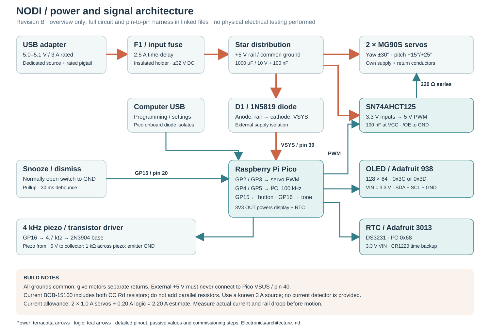

# NODI electrical integration — revision A

**Status:** a buildable wiring architecture and compiled proof-of-concept firmware, with host software verification. No electronics have been purchased, assembled, electrically measured, or tested on hardware for this submission. The wiring diagram is a block diagram; this package does not claim a fabricated PCB or a certified consumer product.

## Selected hardware and mechanical interfaces

| Item | Selection and interface | CAD envelope / attachment |
|---|---|---|
| Controller | Original Raspberry Pi Pico, RP2040; 3.3 V GPIO | 51 × 21 mm board; socketed/soldered to removable rear carrier |
| Actuators | Two genuine Tower Pro MG90S analog servos, supplied at nominal 5 V | 22.8 × 12.2 × 28.5 mm body; manufacturer 13.4 g; verify purchased flange and horn geometry before print release |
| Display | Adafruit 938, **current 2024 revision**, SSD1306, 128 × 64, I²C | 35.6 × 33 × 6.2 mm envelope; Ø2.5 holes on 30.5 × 28 mm rectangle; behind face at X = 0, Z = 90 mm |
| RTC | Adafruit 3013 DS3231 with CR1220 backup cell | 23 × 17.6 × 7.2 mm; retained on rear carrier; battery accessible through service cover |
| Snooze control | Adafruit 1119 through-hole tactile switch, normally open | 12 × 12 × 6 mm; 26 × 20 × 1.6 mm printed switch carrier below Ø16 mm cap; CAD switch center X = 0, Y = −36 mm |
| Audio | Murata PKM13EPYH4000-A0, externally driven piezo | Ø12.6 × 6.9 mm, 5 mm lead pitch; separate insulated adhesive mounting pad on free side of base, sound opening toward vent |
| Logic carrier | Printed PETG mounting tray; boards connected by insulated wiring | 80 × 27 × 2 mm, rear base; Pico and RTC retained on insulating adhesive pads, no tall headers |
| Power carrier | Printed PETG mounting tray carrying FR-4 perfboard | 35 × 28 × 2 mm tray, 31 × 24 × 1.6 mm perfboard, side of yaw servo; diode, buffer, capacitors and driver; keep tallest part below Z = 25 mm; inline fuse near cable inlet |

Dimensions are manufacturer nominal envelopes and CAD design interfaces, not measured incoming inspection results. The screen glass is 34.5 × 23 mm; its **lit area is only 29.42 × 14.70 mm**. The black surrounding face window in renders is cosmetic; it is not a larger electronic display. Confirm the exact module revision before ordering because older Adafruit 938 boards have different dimensions.

## Power distribution

Use a certified, regulated **5.0–5.1 V, 3 A USB power supply** with a cable and input pigtail rated for 3 A continuous. One suitable supply family is the Raspberry Pi 15 W USB-C supply (5.1 V, 3 A); a USB-C input pigtail must include **separate 5.1 kΩ Rd resistors on CC1 and CC2** and be rated for 3 A. This prototype is restricted to its dedicated 3 A adapter: the wiring has no USB current-advertisement detector and must not be powered from an arbitrary computer USB port. A USB-A supply with explicitly rated 5 V / 3 A output and a matching rated pigtail is an alternative. The final pigtail supplier is an open procurement item; inspect its conductors, CC implementation and continuity before energizing.

The flexible pigtail enters the rear Ø7.2 mm cable passage through a correctly sized grommet and an internal nylon-tie clamp around a protective sleeve. Two Ø2.5 mm floor holes at X = 45 mm, Y = 24/32 mm provide its mechanical anchor; keep the underside tie loop below 2.5 mm thickness, within the 3 mm feet clearance. The cable hole is not a USB-C receptacle cutout. An external molded connector remains outside the housing, avoiding an unsupported connector solder joint at the wall. Main 5 V passes through a **2.5 A time-delay fuse** rated for at least 32 V DC, with insulated holder, into the star distribution point. Use 20–22 AWG supply/return and short 24 AWG servo branches; all solder joints are insulated. Fuse time/current performance, cable rating and supply protection still need physical coordination testing.

- The servo +5 V leads and SN74AHCT125 VCC connect directly to the fused rail. The servo rail does **not** pass through the Pico board or its regulator.
- A **1N5819 Schottky diode**, anode at fused +5 V and banded cathode at Pico VSYS (physical pin 39), feeds logic power. Pico's onboard USB-to-VSYS diode and this external diode isolate the two supplies. Never join external +5 V to Pico VBUS (physical pin 40), and never bridge VBUS and VSYS.
- Pico 3V3 OUT (pin 36) supplies OLED VIN and RTC VIN. Their logic and pullups therefore remain at 3.3 V. Do not power the RTC or OLED I²C pullups from the servo rail.
- Connect all grounds at the distribution point. Give servos their own return conductors, avoiding motor current through the I²C ground path. The programming USB ground joins this common ground. USB can operate Pico and settings with the actuator supply unplugged; it cannot feed the servo rail through the added diode.
- Place **1000 µF / 10 V low-ESR** plus **100 nF ceramic** across the servo distribution rail. Add 100 nF directly across AHCT125 pins 14 and 7. Bulk capacitance suppresses brief edges; it cannot substitute for a sufficient supply: ΔV = I Δt / C gives 2 V for 2 A over 1 ms with 1000 µF.
- Keep the coin cell within the selected Adafruit holder. It preserves time, **not the alarm sound or motion**, during an outage. Use only the intended non-rechargeable CR1220; no charging circuit is included. Retain the small cell behind a screwed service cover.

The current budget is an **estimate**, because Tower Pro does not specify MG90S stall current on the linked manufacturer page:

| Load | Design allowance |
|---|---:|
| Yaw servo, abnormal/high load | 1.0 A assumed |
| Pitch servo, abnormal/high load | 1.0 A assumed |
| Pico, display, RTC, buffer and audio combined | 0.20 A reserved |
| Total / 3 A supply margin | 2.20 A / 0.80 A |

Acceptance before motion: measure 4.8–5.3 V at the servo connectors during simultaneous start/reversal and confirm no Pico reset. Measure actual running and blocked-rotor current with a current-limited supply and a brief controlled test; reassess fuse and source sizing if either exceeds the allowances. Servo stalls are a fault condition. Firmware does not sense motor current, temperature, actual angle, or jam events; it has no automatic jam cutoff. The builder must cut actuator power immediately on binding.

## Pin assignments and point-to-point wiring

GPIO numbers below are **GP numbers**, not Pico header pin numbers.

| Signal | Pico GP / physical pin | Destination / wiring |
|---|---|---|
| Yaw command | GP2 / pin 4 | AHCT125 1A pin 2; 100 kΩ to ground; 1Y pin 3 → 220 Ω → yaw signal |
| Pitch command | GP3 / pin 5 | AHCT125 2A pin 5; 100 kΩ to ground; 2Y pin 6 → 220 Ω → pitch signal |
| I²C SDA | GP4 / pin 6 | OLED SDA and RTC SDA, 3.3 V bus |
| I²C SCL | GP5 / pin 7 | OLED SCL and RTC SCL, 100 kHz bus |
| Snooze/dismiss | GP15 / pin 20 | Normally open switch to GND; firmware INPUT_PULLUP; 30 ms debounce |
| Audio command | GP16 / pin 21 | 4.7 kΩ → 2N3904 base; 100 kΩ base–emitter; emitter to GND |
| External logic input | VSYS / pin 39 | External Schottky cathode, never VBUS |
| Logic rail output | 3V3 / pin 36 | OLED VIN, RTC VIN |
| Common return | GND / pins 3, 8, etc. | Logic ground to star return |

**AHCT125:** use the TTL-input **AHCT** version; an HC125 is not an equivalent 3.3-to-5 V solution. Pin 14 = fused +5 V, pin 7 = GND. Tie active channel /OE pins 1 and 4 to GND. Tie unused /OE pins 10 and 13 to +5 V and unused A pins 9 and 12 to GND; leave outputs 8 and 11 unconnected. Its guaranteed VIH = 2.0 V at VCC = 4.5–5.5 V accepts Pico 3.3 V logic, and its outputs deliver a 5 V servo signal. The servo input pull-downs prevent floating commands during Pico reset; they do not establish a measured physical head position.

**Audio driver:** piezo positive to fused +5 V, negative to 2N3904 collector; place **1 kΩ** across the piezo to discharge it on each off cycle. A 4 kHz tone drives the transistor, with 400 ms sound / 600 ms quiet cadence. This is a piezo, not a magnetic coil; if substituted with a coil buzzer, redesign the driver and add appropriate flyback protection. Prototype sound pressure remains unmeasured. Check transistor pinout for the purchased package.

**I²C:** selected modules have pullups. Check the parallel effective pullup resistance on the actual boards before adding any others; aim for 2.2–10 kΩ at 100 kHz and short wiring. OLED 938 ships with address selection 0x3C/0x3D; firmware probes both. DS3231 is 0x68. The display's four fine-stranded conductors and pitch servo's three wires form a ≤3.5 mm harness bundle, leaving at least **80 mm free length** in a loose external rear service loop. Route it through the head's Ø8 mm bottom opening at X = 0, Y = +15 mm and the fixed deck's Ø10 mm grommet bore at X = 0, Y = +34 mm. Use a grommet with approximately Ø6 mm free ID and clamp each end with slack; keep the loop outside/above the yoke's rear edge, clear of the horn, stops and pitch pivot. The moving servo case carries its cable through both yaw and pitch. **Do not route the harness through the central yaw pilot:** the installed horn occupies that space. Leave ≥15 mm bend radius and physically sweep every combined limit before energizing. Harness flexibility and fatigue are not represented by a deformable CAD model.

## Assembly and commissioning

1. Solder and continuity-check the carriers outside the enclosure; verify connector polarity, diode direction, no +5 V–GND short, and no +5 V connection to Pico VBUS. Inspect insulation and exposed leads.
2. With servos unplugged, apply current-limited 5 V. Confirm VSYS, 3.3 V and display/RTC I²C addresses. Program the Pico via its accessible service port before closing the cover.
3. Set time and alarm over USB as described in [firmware instructions](../Firmware/README.md). Disconnect the computer; confirm clock starts and retains time from the coin cell after a power cycle.
4. With **horns mechanically disconnected**, power the servos and command the neutral pulse (1500 µs). Fit horns with yaw = 0°, pitch = 0°; verify pulse direction and measure actual angle per pulse before enabling full travel. Pulse-to-angle calibration is an open hardware task, not an established characteristic of every MG90S.
5. Begin at ±5°. Check axis signs, then increase gradually to yaw ±30°, pitch −15°/+25°. Positive pitch lowers the face; negative pitch lifts it. Preserve at least 5° to physical stop contacts and verify cable sweep.
6. Test alarm, short-press five-minute snooze, ≥1.5 s hold dismissal, restart behavior, source droop, acoustic level and case temperature. Log physical results in a future validation revision.

## Primary references

Accessed 2026-10-24. Product prices in the BOM are preliminary estimates, not quotations.

- [Tower Pro MG90S manufacturer specification](https://torqpro.com/product/mg90s-analog/): body dimensions, mass, 1.8 kgf·cm stall torque at 4.8 V, nominal performance. Stall torque is not continuous operating torque.
- [Raspberry Pi Pico datasheet](https://datasheets.raspberrypi.com/pico/pico-datasheet.pdf), power section: VSYS range and Schottky OR-ing of an external supply with USB.
- [Raspberry Pi 15 W USB-C supply](https://www.raspberrypi.com/products/type-c-power-supply/): 5.1 V, 3 A dedicated adapter example.
- [Adafruit 938 OLED](https://www.adafruit.com/product/938): current revision mechanical dimensions, SSD1306, address options, logic support and display aging considerations.
- [Adafruit 3013 DS3231 module](https://www.adafruit.com/product/3013), [Analog Devices DS3231](https://www.analog.com/en/products/ds3231.html): module envelope, CR1220 backup and compensated RTC architecture.
- [Adafruit 1119 tactile switch](https://www.adafruit.com/product/1119): 12 × 12 × 6 mm nominal switch.
- [TI SN74AHCT125 datasheet](https://www.ti.com/lit/ds/symlink/sn74ahct125.pdf): supply, pinout and input/output limits.
- [Diodes Inc. 1N5819](https://www.diodes.com/part/view/1N5819): external logic isolation diode.
- [Murata sound components catalogue](https://www.murata.com/~/media/webrenewal/support/library/catalog/products/k70e.ashx?la=en-us), pin-type sounder section: PKM13EPYH4000-A0 dimensions and external-drive resonance. Availability and approved replacement should be checked during procurement.

