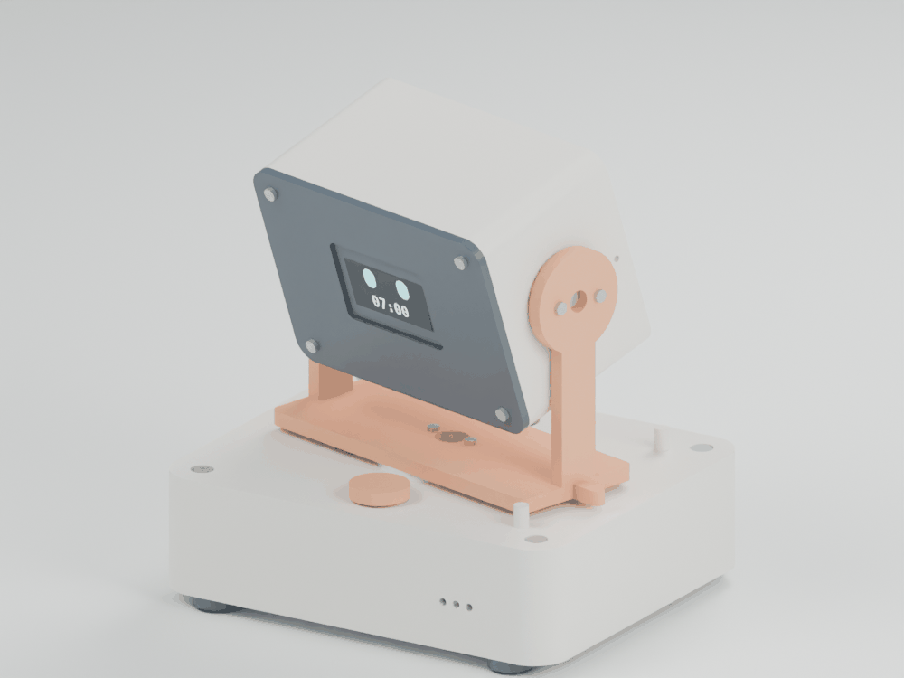
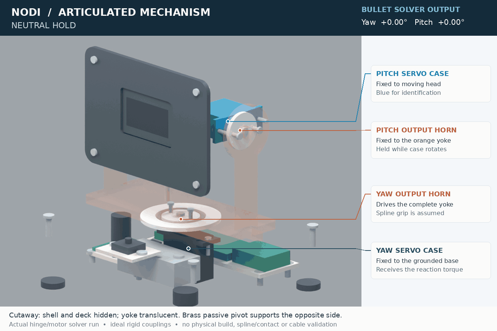
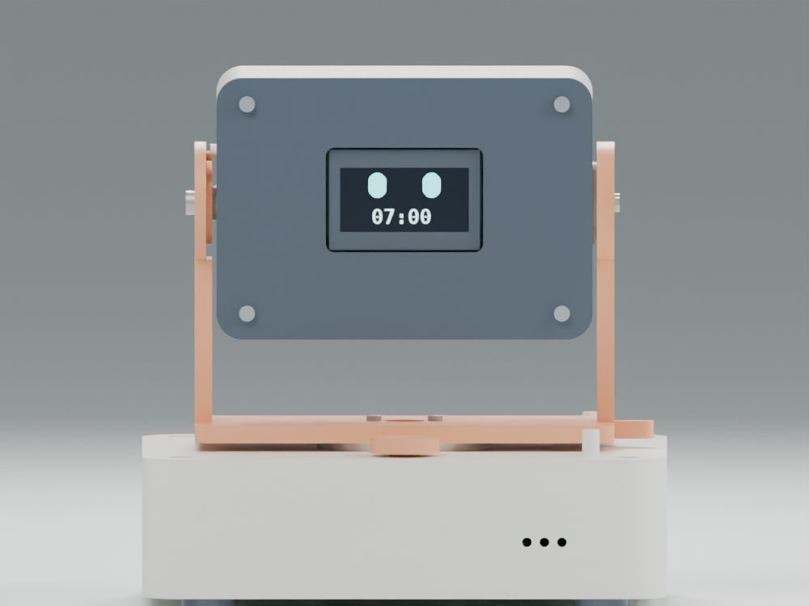
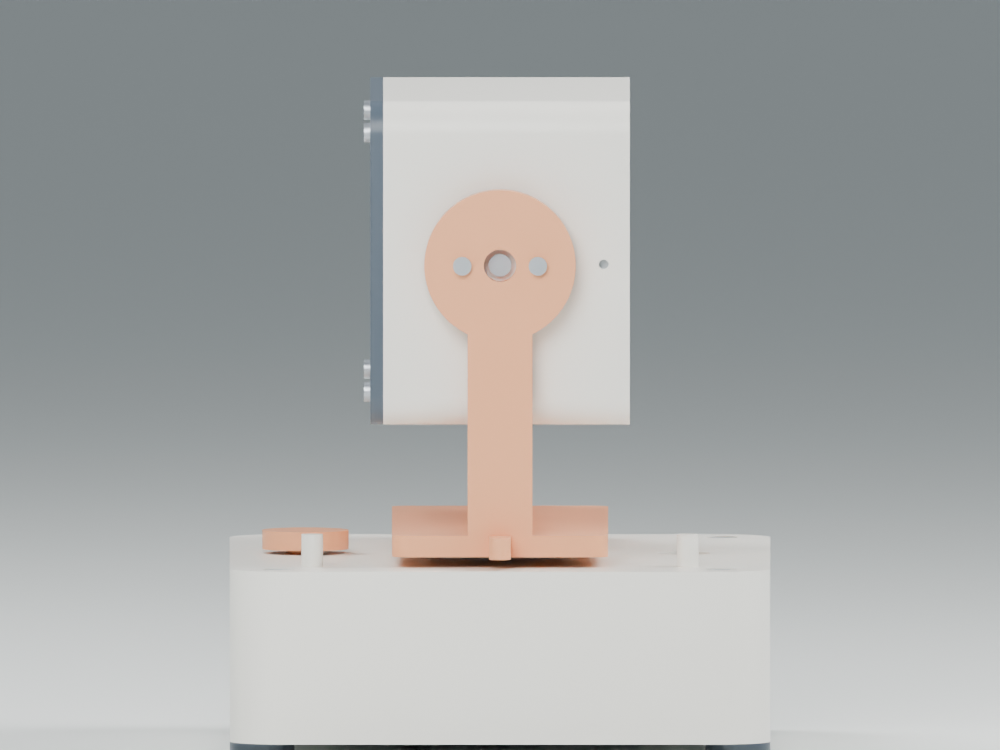
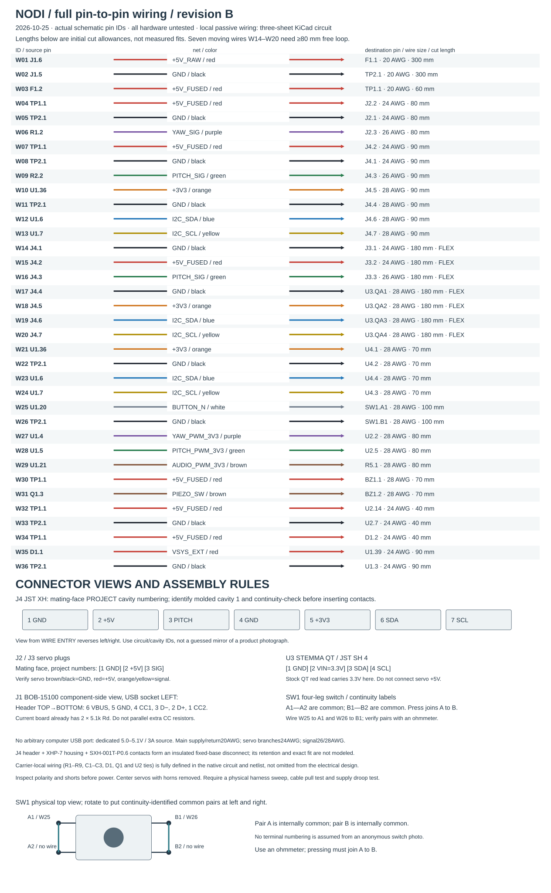

# NODI — a little clock that wakes up with you

**An expressive, two-axis robotic alarm clock.** Sleepy at rest, reluctant when snoozed, cheerful when you get up.


[**Read the engineering report (PDF)**](Documentation/NODI_Engineering_Design_Report.pdf) · [**Download the STEP assembly**](CAD/exports/NODI_Assembly_RevA.step) · [**Manufacturing drawing (PDF)**](Drawings/NODI-P03_Yoke_RevA.pdf)

[**Full electrical schematic**](Electronics/Schematics/NODI_System_RevB.pdf) · [**Pin-by-pin wiring**](Electronics/Wiring/NODI_Wiring_RevB.pdf) · [**Articulated joint model**](CAD/Kinematics/README.md)

Prepared for Human Computer Lab's Mechanical Engineering Internship challenge · David Borsky · Mechanical revision A / electrical revision B · October 2026

> **Evidence status:** This is an unbuilt digital engineering proof of concept. The parametric CAD, exports, calculations and software checks were executed. Renders show the actual CAD with illustrative OLED pixels. Hardware performance remains untested; no FEA was run. [Design provenance and evidence boundaries](Documentation/design_provenance.md).

## A character made from motion

NODI slowly raises its head before the alarm, looks around and nods while ringing, droops for a five-minute snooze, and lifts its head when dismissed. A short button press snoozes; a 1.5-second hold dismisses the active alarm. Time and alarm settings are configured through USB serial and retained by the RTC and controller.

The name NODI comes from its nodding motion; it is a character name, not a technical acronym.



*Discrete CAD key poses illustrate the character; this is not a recording or a time-accurate trajectory animation.*

The motion uses bounded quintic trajectories rather than instant angle jumps. See the [executed command-motion plots](Analysis/command_motion_profiles.pdf), [motion samples](Analysis/motion_profile.csv), and [controller state logic](Firmware/NODI/NodiCore.h). These describe commanded motion, not measured servo response.

| Design specification | Value / status |
|---|---|
| Physical axes | Yaw ±30°; pitch −15° to +25° |
| Base / head | 120 × 100 × 32 mm / 86 × 48 × 60 mm |
| Pitch axis | 88 mm above base datum; passive pivot opposite the motor |
| Motion limits | ≤60°/s and ≤180°/s² commanded; calibration required |
| Mass | 375.5 g CAD material/envelope estimate; 489.3 g design budget; 500 g target |
| Actuation | Two Tower Pro MG90S analog microservos, 5 V rail |
| Time / display | Raspberry Pi Pico, DS3231 RTC, 128 × 64 OLED |
| Power | Dedicated regulated 5 V / 3 A USB supply, fused rail, Schottky-fed logic |
| Prototype process | PETG FFF shells/yoke; cut PTFE thrust washer; retained steel ballast |
| Assembly target | ≤30 min, excluding fabrication, wiring and programming; unmeasured |

## The mechanism

The STEP assembly is static. The separate [articulated Blender model](CAD/Kinematics/NODI_Articulated_RevA.blend) contains two hinge joints and two angular motors. Bullet solved the yaw and pitch sequence without keyframing the body placements; the [joint results](CAD/Kinematics/solver_validation.json) and [source/URDF instructions](CAD/Kinematics/README.md) are included.



*Ideal joint demonstration: zero gravity, inter-link collisions disabled, approximate inertia and assumed rigid servo/horn couplings. It establishes the intended articulation, not real servo performance or physical fit.*

The yaw servo turns a U-yoke through a match-drilled disc horn. An annular PTFE thrust washer supports the rotating table; a printed pilot locates it radially. The washer is intended to relieve the servo shaft; actual axial load sharing with the horn and deck has not been established.

The pitch servo is mounted **inside the head**. Its horn is fixed to the yoke, so the servo case and head rotate together. A retained brass sleeve and M3 fastener support the opposite side. Sleeve rotation is not positively locked in the current geometry. Printed stops sit beyond software travel. Cable service loops pass through the head's lower opening and the open rear of the mechanism.

The [mechanism audit](Documentation/mechanism_audit.md) identifies open spline compatibility, endfloat, axial-load sharing and tool-access issues. These must be resolved on measured hardware before the design can be claimed to work physically.


[Exploded STEP](CAD/exports/NODI_Exploded_RevA.step) · [Part identification and counts](Manufacturing/BOM.csv) · [Detailed assembly instructions](Manufacturing/assembly_instructions.md)

| Front assembly | Side assembly |
|---|---|
|  |  |

[Top view](Images/nodi_top.png) · [Internal component view](Images/nodi_cutaway.png). The internal view omits covers and shells to expose components; it is not a physical assembly state.

## Engineering decisions and results

Three mechanisms were scored against eight criteria. Pan-tilt scores **4.13/5**, single-axis nodding **3.93/5**, and mechanical eyelids **3.05/5**. A 40% expressiveness weight selects pan-tilt; shifting five percentage points to simplicity creates a tie. Single-axis nodding wins with equal weights. The [decision matrix](Documentation/concept_selection.md) makes that preference explicit.

| Reproducible analytical result | Interpretation |
|---|---|
| Pitch torque: 0.0347 N·m, including 2× load factor | 1.27× reserve against a designer budget of 25% of rated stall torque |
| Yaw torque: 0.0136 N·m | 3.25× reserve against the same assumed operating budget |
| Yoke stress / displacement: 0.545 MPa / 0.113 mm | Reduced assumed PETG properties and a 3 g vertical proof case; no FEA or coupon test |
| Deck beam surrogate: 0.80 mm at 3 g; 0.27 mm at 1 g | Rough compliance estimate; check pilot/horn rubbing under load; whole-assembly stiffness remains unverified |
| Push-plus-motion stability: 1.17× moment reserve | Added retained ballast and outboard feet after the initial 0.80× result failed |
| Static tipping angle: 34.7° | Conservative mass and center-of-gravity assumptions; physical tilt test still required |
| Finished pilot clearance: 0.30 mm minimum diametral | Requires specified finishing/gauging; as-printed tolerance stack can close the gap |
| Rail current budget: 2.20 A / 3 A source | Servo current is an assumption; simultaneous-stall and brownout tests required |
| Surface temperature estimate: 36.6–46.6 °C at 30 °C ambient | The conservative case exceeds the 45 °C target; thermal acceptance remains open |

Stall torque is not continuous torque. The manufacturer's 4.8 V stall value is **0.1765 N·m**; the **0.0441 N·m** operating budget is a design assumption requiring loaded current and temperature measurements. Stability assumes at least **301 g** as-built mass and the stated CG bounds; infill can reduce the fully solid CAD mass. Weigh the prototype before accepting that result. Head mass, bounding-box inertias, cable drag, fastener bearing, stops, stability, tolerances and heat assumptions are documented in the [engineering analysis](Analysis/engineering_analysis.md) and [input file](Analysis/analysis_inputs.json). The [ballast and foot-placement iteration](Documentation/design_iteration.md) preserves the initial failed stability screen and the resulting mechanical change.

The final mechanical checks record **67 valid solid bodies**, matching STEP readbacks, and **490 targeted solid-pair checks at 1° increments with no intersections**. The minimum checked head/yoke separation is 1.00 mm. [Coverage and limits](CAD/motion_validation.json). These are digital geometry checks.

## Manufacturing and assembly

The prototype uses nine printable custom rigid parts, standard screws, replaceable purchased modules and a machined stock ballast. The complete BOM totals **$112.27 in preliminary material/component allowances**, excluding labor, shipping, tools and certification. The removable deck, electronics trays and bezel expose service joints. [Materials and DFM/DFA](Manufacturing/materials_and_processes.md) distinguishes the PETG prototype from a future PC-ABS molding redesign with draft, uniform walls, ribs and tooling review.


[Two-sheet yoke drawing (PDF)](Drawings/NODI-P03_Yoke_RevA.pdf) · [Editable vector drawing source](Drawings/generate_yoke_drawing.py) · [Drawing/CAD parameter agreement](Drawings/drawing_geometry_check.json)

The yoke drawing defines functional datums, axis position tolerances, bearing fits, stop locations and process notes using ASME Y14.5 principles. It is a prototype definition requiring inspection, not a released production drawing.

## Electrical integration and software

[**Circuit schematic PDF — power, controller interfaces, servo drivers and audio**](Electronics/Schematics/NODI_System_RevB.pdf) · [Editable KiCad source](Electronics/Schematics/NODI_System_RevB.kicad_sch)



[Printable wiring PDF](Electronics/Wiring/NODI_Wiring_RevB.pdf) · [Wire schedule](Electronics/wiring_schedule.csv) · [Pin/net list](Electronics/netlist.csv) · [Electrical checks](Electronics/validation.json)

The circuit includes individual component values and reference designators, Pico GP/header numbers, used and unused module pins, both USB-C CC terminations, the isolated logic feed, servo buffering, piezo driver and moving head harness. Module internal circuits remain vendor designs linked in the electrical documentation. This is a system wiring/schematic package, not a routed custom PCB.

[Wiring, pin assignments and power architecture](Electronics/architecture.md) · [Firmware and build instructions](Firmware/README.md) · [Actual compiler and host-test results](Firmware/verification_results.md)

The Pico sketch compiles for the ARM target. Fifteen host scenario groups pass, including midnight, snooze, dismissal, clock invalidity, reboot consumption, debounce, timer rollover and trajectory limits. The physical RTC, display, audio, flash retention, pulse-to-angle calibration and power circuitry have not been tested.

## Review or regenerate

1. Open [the assembly STEP](CAD/exports/NODI_Assembly_RevA.step) in FreeCAD, SolidWorks, Onshape or another STEP-capable modeler. STEP contains named/colorized component instances; it does not preserve a SolidWorks feature tree.
2. Edit [CAD/parameters.json](CAD/parameters.json) and [CAD/build_nodi.py](CAD/build_nodi.py) for parametric source. Use [CAD instructions](CAD/README.md) for export layout, coordinates, mounting assumptions and validation coverage.
3. Download [printable STLs](CAD/exports/STL) individually, or clone the repository. STLs are nominal geometry; orient parts and inspect coupons before printing.

```bash
python3.11 -m venv .venv
source .venv/bin/activate
python -m pip install -r requirements.txt
python CAD/build_nodi.py
python CAD/check_motion.py
python CAD/verify_exports.py
python Analysis/engineering_calculations.py
python Analysis/plot_analysis.py
python Drawings/generate_yoke_drawing.py
bash Firmware/tests/run_tests.sh
python Electronics/verify_electrical.py
python Manufacturing/build_bom.py --check
python tools/compose_showcase.py
python tools/build_report.py
python tools/audit_package.py
```

Optional renders require Blender 4.5.3: `blender -b --python tools/render_cad.py -- hero` (also `exploded`, `front`, `side`, `top`, `cutaway`, `sleepy`, `awake`, `cheerful`). [Render source](tools/render_cad.py) imports exported CAD meshes; [the Blender scene](CAD/nodi_render_scene.blend) is included for visual review. Compiler setup is pinned separately in the firmware README.

Use the [articulated-model instructions](CAD/Kinematics/README.md) to regenerate the joint solver run. Electrical source regeneration, KiCad exports and rule-check commands are documented in [the electrical architecture](Electronics/architecture.md).

| Deliverable | Files |
|---|---|
| Editable CAD, STEP and STL | [CAD](CAD/README.md), [assembly](CAD/exports/NODI_Assembly_RevA.step), [parts](CAD/exports/STEP), [print files](CAD/exports/STL) |
| Renders and exploded view | [Images](Images), [exploded assembly STEP](CAD/exports/NODI_Exploded_RevA.step) |
| Manufacturing drawing and GD&T | [Drawing PDF](Drawings/NODI-P03_Yoke_RevA.pdf), [editable source](Drawings/generate_yoke_drawing.py) |
| Calculations and numerical evidence | [Analysis](Analysis/engineering_analysis.md), [machine-readable results](Analysis/analysis_results.json) |
| Materials, BOM and assembly | [Process plan](Manufacturing/materials_and_processes.md), [BOM](Manufacturing/BOM.csv), [assembly](Manufacturing/assembly_instructions.md) |
| Functional integration | [Circuit schematic](Electronics/Schematics/NODI_System_RevB.pdf), [wiring](Electronics/Wiring/NODI_Wiring_RevB.pdf), [firmware](Firmware/README.md) |
| Articulated mechanism | [Native joint model](CAD/Kinematics/README.md), [solver record](CAD/Kinematics/solver_validation.json), [mechanism audit](Documentation/mechanism_audit.md) |
| Requirements and proposed tests | [Verification matrix](Documentation/requirements_and_verification.md) |
| Development and launch | [24-hour scope and 30-week roadmap](Documentation/development_timeline.md) |
| Final report | [PDF](Documentation/NODI_Engineering_Design_Report.pdf), [editable Markdown](Documentation/engineering_report.md) |
| Package checks | [Verification summary](Documentation/verification_summary.md), [public access verification](Documentation/publication_verification.json), [audit record](Documentation/package_audit.json), [CAD checks](CAD/validation.json), [drawing check](Drawings/drawing_geometry_check.json) |

## What remains before a physical proof of concept

Fabricate and gauge the parts, verify the actual servo/horn lot, assemble the harness, calibrate travel, measure head mass and cable drag, and test loaded torque/current, stability, acoustics, temperature and reliability. The 490 g budget leaves limited mass-growth allowance. FFF creep, local stress concentrations, fatigue and finger clearance require physical evaluation. The thermal upper estimate misses its target; reduce measured losses or improve heat rejection before accepting it.

The [verification matrix](Documentation/requirements_and_verification.md) defines acceptance criteria. The [development roadmap](Documentation/development_timeline.md) separates this digital challenge package from EVT, DVT, tooling, PVT and commercial release. No physical performance or product certification is claimed.
